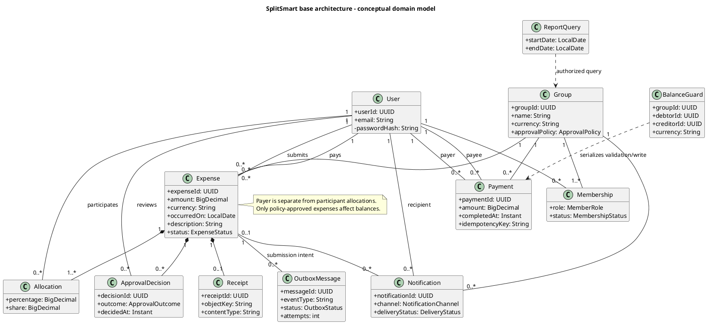
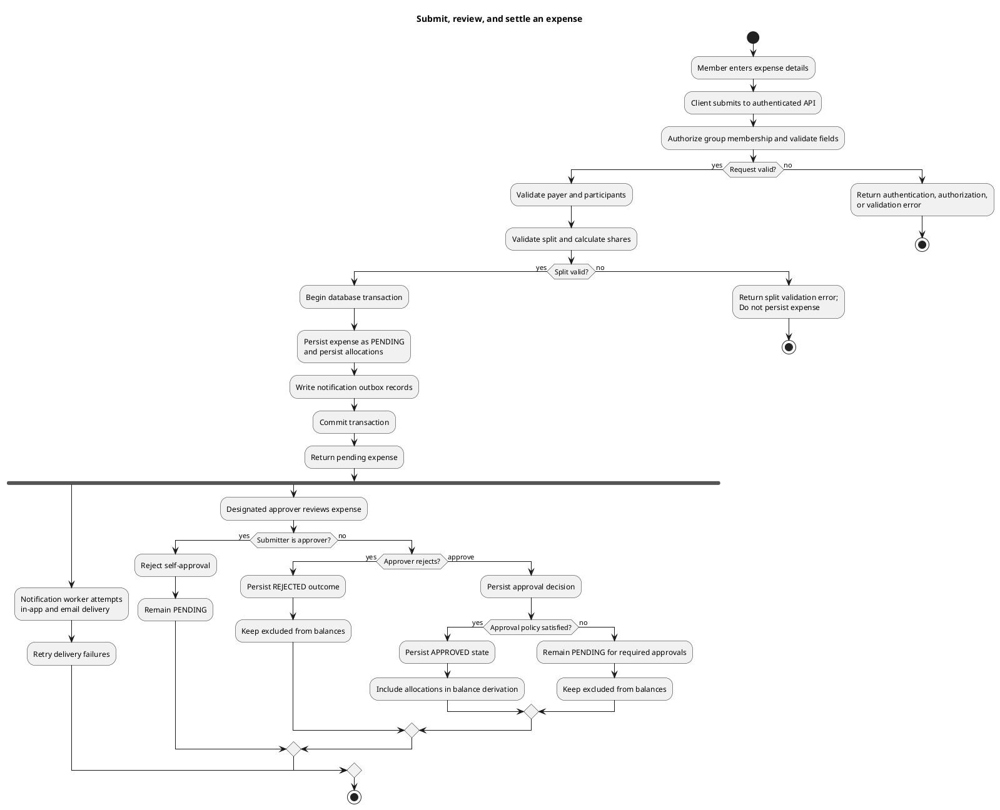

# SplitSmart Final Design

**Architecture**: Selected base modular backend; see [final-architecture.md](./final-architecture.md).  
**Requirements**: [final-requirements.md](./final-requirements.md).

The following UML is PlantUML source as required by the project constitution. The class diagram describes the conceptual domain, not a physical database or ORM schema.

## Conceptual class diagram

## Activity diagram: submit, review, and balance update

Notification delivery runs asynchronously after the expense transaction commits. The notification branch does not gate review or balance processing; email outages cannot delay approval. Pending and rejected expenses never change balances.

## JUnit 5 test cases

These are planned tests, not reported test results. Business-rule tests should use the domain/application layer without constructing a Swing UI. Database concurrency and rollback behavior require integration tests against the selected relational database.

| Test ID | Scenario and setup | Expected result |
|---|---|---|
| **FD-001 — Equal split rounding** | Submit `$10.00` split equally among three participants. | Shares total exactly `$10.00`; each receives `$3.33` plus one participant receives `$3.34`. Proposed deterministic tie-break: ascending stable participant ID receives the leftover cent. Assert the exact recipient and record that this tie-break needs confirmation. |
| **FD-002 — Percentage split rounding** | Allocate an amount using valid percentages totaling exactly `100.00%`, where raw shares require minor-unit rounding. | Each percentage has at most two decimal places; calculated shares use largest remainder, have currency scale, and sum exactly to the total. Inputs over precision or totaling other than exactly 100% are rejected. |
| **FD-003 — Pending/rejected do not change balance** | Capture balances, submit an expense, then reject it; separately retain one expense pending. | Balance contributions of both pending and rejected expenses are zero. Neither state creates an approved allocation effect. |
| **FD-004 — Approval policy gates balance** | Submit an expense configured for multiple approvals; approve only one required level, then satisfy the remaining policy. | After the first decision the expense remains pending and excluded. Only after the complete policy is satisfied does it become approved and enter balance derivation. |
| **FD-005 — Prevent self-approval** | Submit an expense as user A and attempt to approve it as user A, even if A is otherwise designated an approver. | Decision is rejected; no approval decision that satisfies the policy is applied; expense remains pending and has no balance effect. |
| **FD-006 — Concurrent payment limit** | Starting outstanding balance is `$20.00`. Submit two concurrent `$15.00` payment requests with distinct idempotency keys; synchronize them so both initially contend for the same pair. | Pair guard locking serializes validation and write. Exactly one payment commits; the second re-reads outstanding balance `$5.00` and is rejected. Final recorded payment total is `$15.00`, outstanding balance is `$5.00`, and no overpayment occurs. |
| **FD-007 — Payment retry idempotency** | Retry the same successful payment request with its original idempotency key. | Existing payment result is returned or recognized; payment history and balance reflect it exactly once. |
| **FD-008 — Notification failure independence** | Submit a valid expense while email delivery fails. | Expense is committed as pending and remains pending; balances do not change. Outbox work is retained for retry; no email failure can approve/reject the expense. |

### Concurrent-payment integration procedure

1. Seed an approved obligation of `$20.00` and no payments for one group/debtor/creditor/currency pair.
2. Start two payment transactions concurrently with a barrier so both requests contend close together.
3. Assert that the transactions serialize on the same balance guard, each re-reads the obligation after acquiring its lock, and only one `$15.00` payment succeeds.
4. Assert one payment record, one corresponding balance reduction, `$5.00` still outstanding, and an explicit overpayment rejection for the losing request.
5. Retry the winning request's idempotency key and assert there is still only one payment.
6. Include an integration case where an expense approval changes the same pair's obligation concurrently; approval and payment code must acquire affected guards in stable order and maintain a serializable outcome.

## Outstanding design detail

Largest-remainder allocation can produce tied fractional remainders. The design proposes ascending stable participant ID as a deterministic secondary ordering so tests and clients see repeatable cents. This behavior is not specified by the source requirements and needs product confirmation; see [final-requirements.md](./final-requirements.md).
