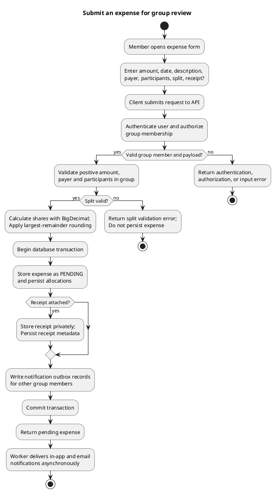
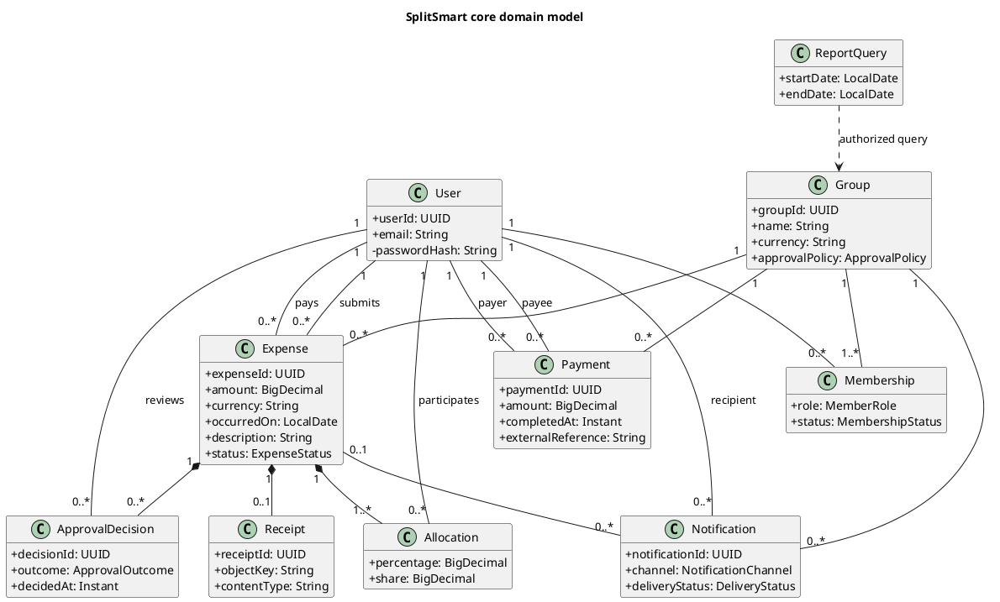

# SplitSmart Base Architecture Plan

**Branch**: `001-splitsmart-expense-sharing` | **Date**: 2026-11-05 | **Spec**: [spec.md](./spec.md)

## Purpose and scope

This is a base architecture for the complete SplitSmart product, with the Java Swing MVP treated as an initial client and delivery slice—not as a substitute for the customer's web, Android, or iOS requirements. It describes component boundaries, expense submission, data ownership, and a deployment approach. It is a planning document only; it does not create application code or settle the open product questions in the specification.

The design uses a shared, remotely hosted application backend so all clients operate on the same groups, expenses, approvals, balances, and payments. The web experience is the primary full-product client. Android and iOS clients are planned against the same backend contract. A Java 21 Swing client can exercise the MVP scope against that backend. Its completion alone does not satisfy FR-018–FR-020 or AC-010.

## Summary

Use a modular Java 21 backend, built with Maven, with a versioned HTTPS API and a relational system of record. Separate the client interfaces from application use cases and domain rules. The expense application service validates and allocates an expense, stores it pending review, and emits an outbox event in one database transaction. An asynchronous notification worker delivers in-app and email notifications. Approval decisions are persisted separately; only a policy-satisfied approval makes an expense eligible for balance calculations. Balances are derived from approved allocations and completed external payment records, not from pending/rejected expenses or transfer processing.

Serve receipt images through private object storage using short-lived, authorization-gated access. Deploy the backend and notification worker as separate Java processes/containers, with managed relational storage, private object storage, and external email delivery. Deliver the Swing MVP as a desktop client to the same API. Add the web and mobile clients as distinct presentation clients when their technology and delivery sequence are agreed.

## Technical Context

**Language/Version**: Java 21 for production Java; client technologies outside Java/Swing remain to be selected.

**Primary Dependencies**: Maven; Java Swing for the desktop MVP; Java HTTP service framework and API specification format to be selected during implementation. No framework is mandated by the spec or constitution.

**Storage**: Relational database recommended for transactional group, expense, approval, allocation, payment, notification, and outbox records; private object storage recommended for receipt bytes. Database and cloud provider are not specified by current requirements.

**Testing**: JUnit 5. Unit tests for money allocation, approval policy, balance derivation, and authorization; integration/contract tests for persistence and API behavior; client workflow checks for supported platforms.

**Target Platform**: Hosted Linux service for API and notification worker; desktop JVM for the Swing MVP. Full-product web, Android, and iOS clients remain required and are not delivered by Swing.

**Project Type**: Multi-client application with a modular backend service.

**Performance Goals**: Proposed target is at least 95% of common actions complete or show a result within 2 seconds. Operating load, action set, and test environment require agreement (NFR-003, AC-011, SC-004).

**Constraints**:
- Monetary amounts, rates, shares, and calculations use `BigDecimal`; currency minor-unit scale and rounding mode must be explicit. Allocation uses the specified largest-remainder rule.
- Pending and rejected expenses do not affect balances. Completed external payments are recorded once, cannot exceed the outstanding amount, and do not initiate a transfer.
- Group data, reports, and receipts are accessible only to authorized members; membership changes are restricted to group admins.
- Expense submitters cannot approve their own submissions.
- Java Swing is the desktop MVP UI; business rules remain outside Swing event handlers.
- A Swing-only release leaves FR-018–FR-020 and AC-010 unmet; the platform delivery sequence needs explicit product acceptance.

**Scale/Scope**: Initial scope is one group and its members, expenses, allocations, approvals, receipts, payments, notifications, and reports. Production user count, traffic, and data-retention requirements are unspecified; avoid sizing infrastructure beyond the agreed operating load.

## Architecture and component responsibilities

1. **Presentation clients**
   - **Swing MVP**: Java 21 desktop UI for the MVP feature subset. Views collect input and display results; event handlers call application interfaces and contain no business rules.
   - **Web (primary full-product client)**, **Android**, and **iOS**: separate clients consuming the same authenticated API. Their implementation technology is intentionally not assumed here. Client capability and rollout must be tracked against FR-018–FR-020.
   - All clients use server-calculated money allocations and balances as authoritative values.
2. **API edge and identity**
   - Expose versioned HTTPS endpoints, authenticate registered email/password accounts, and establish an authenticated principal for each request.
   - Apply group membership, admin, approver, and submitter authorization on the server for every protected operation. Client-side checks are only for presentation.
3. **Application services**
   - Coordinate use cases: registration/sign-in, group administration, expense submission, expense review, balance and report queries, payment recording, and receipt access.
   - Enforce transaction boundaries and invoke domain policies. Keep Swing and future client frameworks out of these services.
4. **Domain model**
   - Own validation and behavior for users, groups/memberships, expenses, split allocations, approval policies/decisions, payments, and reports.
   - Calculate split shares with exact decimal arithmetic and the largest-remainder rule. Keep payer identity separate from participants.
   - An expense starts `PENDING`; approval decisions transition it to `APPROVED` only when the configured approval condition is met, or to `REJECTED`. Only approved allocations contribute to obligations.
5. **Persistence and receipt storage**
   - Persist related domain changes transactionally in a relational database. Store receipt metadata and an opaque object key in the database; keep image bytes in private object storage.
   - Authorize receipt access before issuing a short-lived download URL or proxying the image. Never use a public bucket URL as the authorization mechanism.
6. **Outbox and notification worker**
   - Write notification/outbox records in the same transaction that saves a submitted expense, so a notification delivery failure does not lose or approve the expense.
   - A worker retries delivery and records outcomes. Deliver in-app notifications and email to other group members only. Idempotency keys prevent duplicate delivery effects where supported.
7. **Balance and reporting**
   - Derive pairwise obligations from approved expense allocations and recorded completed payments. A payer's credit comes from having paid the expense; the payer's participation in the cost split is independent.
   - Generate summaries/reports from authorized data and validated date ranges. Any future cached or materialized balance view must be rebuildable from the authoritative expense and payment records.
8. **External email provider**
   - Adapter invoked by the worker, not by Swing or a request handler's critical transaction. Provider choice and operational guarantees are deployment decisions.

### Expense submission activity



### Domain class model

This UML is a conceptual model; it does not prescribe ORM classes or a physical schema.



## Request and data flow

1. A client submits an expense over HTTPS. The backend authenticates the user and verifies current group membership, payer/participant membership, and payload validity.
2. The domain allocation policy validates equal or percentage splits. Percentage inputs have at most two decimal places and total exactly 100%. The largest-remainder algorithm allocates minor units so shares sum exactly to the expense total.
3. In a single database transaction, the application persists the pending expense, its allocations and optional receipt metadata, and the outbox work items. Receipt bytes are placed in private object storage through a coordinated upload flow; failed persistence must leave no publicly accessible orphaned receipt.
4. The client receives the pending expense; balances remain unchanged. The worker sends in-app and email notifications asynchronously.
5. A designated approver other than the submitter records a decision. The expense becomes balance-eligible only when the group's approval policy is satisfied; rejection remains visible but excluded.
6. Authorized balance queries derive obligations from approved allocations and completed payment records. Payment recording validates the payer/payee relationship and outstanding amount, persists idempotently, and never invokes money-transfer rails.

## Deployment architecture

### Recommended initial deployment

- **Client distribution**: Package the Swing MVP as a signed Java desktop distribution (installer or runtime image), configured to connect to the hosted API. Do not embed production credentials or database access in the client.
- **Network edge**: HTTPS reverse proxy/load balancer terminates TLS and routes API traffic to the backend. Apply request-size limits (especially for receipt uploads), rate controls, and health checks.
- **Backend API**: Deploy the Java 21 Maven-built service as a stateless container/service. Keep application/domain logic independent from the selected cloud provider.
- **Notification worker**: Deploy a separate Java 21 process/container consuming durable outbox work from the relational store or a queue. Scale independently from API request handling.
- **Database**: Use a managed relational database with encrypted connections/storage, automated backups, and migrations managed with the service release. Keep credentials in a secret manager.
- **Receipt storage**: Use a private, encrypted object store; issue short-lived authorized reads. Apply retention and size/type controls after policy decisions are made.
- **Email delivery**: Integrate a replaceable provider adapter. Keep provider credentials in managed secrets and capture delivery status without changing expense approval state.
- **Operations**: Centralize structured logs, metrics, and traces; monitor API latency/error rate, worker backlog/delivery retries, database health, and backup status. Exclude passwords, tokens, receipt content, and unnecessary personal data from logs.
- **Release pipeline**: Build with Maven on Java 21, run JUnit 5 and integration/contract checks, scan packaged dependencies per project policy, publish immutable service and client artifacts, deploy to a staging environment, run smoke checks, then promote with a rollback path. Human review remains required by the constitution.

Cloud vendor, hosting region, availability objectives, data retention, and production load are not determined by the current spec. Select these before production sizing and acceptance.

### Full-product evolution

The API and backend remain the shared source of truth as the primary web and Android/iOS clients are added. Each client must meet the supported workflow and consistency criteria in AC-010. The client rollout order and delivery date are open questions, not architectural assumptions; do not report the Swing MVP as completion of the platform requirement.

## Constitution Check

| Principle | Plan compliance |
|---|---|
| Java 21 baseline | Backend, worker, and Swing MVP target Java 21; build/release must reject a higher runtime baseline unless governance is amended. |
| Maven build | Maven is the canonical Java build and dependency-management system. |
| Java Swing desktop interface | Swing is the MVP desktop interface; the plan explicitly retains separate web/mobile clients for full-product coverage. |
| JUnit 5 | Required for Java business-rule and boundary tests, including money, approvals, balances, and payments. |
| PlantUML diagrams | The class and submission activity diagrams in this document are PlantUML source. |
| Object-oriented design | Domain objects/policies and application services have separate, cohesive responsibilities; patterns are not prescribed without need. |
| GUI/business logic separation | Swing delegates to application interfaces; business rules remain in domain/application code. |
| BigDecimal for money | Explicitly required for monetary values and allocation. |
| Requirement traceability | Platform gaps and open questions are surfaced; design-to-requirement links are summarized below and in [research.md](./research.md). |
| Human review | This AI-generated plan and diagrams require maintainer review before acceptance. |

**Gate result**: No design violation is proposed. Platform coverage is a known delivery gap, not waived: Swing alone cannot satisfy FR-018–FR-020/AC-010. Obtain and record an approved delivery sequence before claiming full-product conformance. Performance acceptance, currency support, and usability measurement remain open per the spec.

### Requirement-to-component trace

| Requirements | Architectural response |
|---|---|
| FR-001–FR-004, FR-022; AC-001–AC-002 | Identity/API authorization and group/membership domain services |
| FR-005–FR-009, FR-021; AC-003–AC-005 | Expense application service, allocation domain policy, private receipt storage |
| FR-010–FR-013; AC-006–AC-007 | Approval policy/decision service, transactional outbox, notification worker |
| FR-014–FR-015; AC-008 | Balance derivation and idempotent external-payment records |
| FR-016–FR-017; AC-009 | Authorized reporting/query service |
| FR-018–FR-020; AC-010 | Shared API with separate primary web, Android, and iOS clients; rollout remains open |
| NFR-001–NFR-006; AC-011 | Server-side authorization, exact arithmetic, approval gating, idempotency, multi-client contracts, performance observation |

## Project structure proposal

This is a target layout, not a claim that source directories already exist.

```text
specs/001-splitsmart-expense-sharing/
├── plan.md
├── research.md
├── data-model.md
├── quickstart.md
└── contracts/
    └── api-contract.md

backend/
├── pom.xml
├── src/main/java/.../
│   ├── api/             # HTTP endpoints, request/response mapping
│   ├── application/     # Use cases and transaction coordination
│   ├── domain/          # Entities, value objects, domain policies
│   └── infrastructure/  # Persistence, object storage, email, outbox
└── src/test/java/.../   # JUnit 5 unit, integration, and contract tests

clients/
├── desktop-swing/       # Java 21 MVP
├── web/                 # Full-product primary web client (technology TBD)
├── android/             # Native/platform implementation TBD
└── ios/                 # Native/platform implementation TBD
```

**Structure decision**: A shared backend with a separated Swing desktop client and planned web/mobile clients keeps business rules and records consistent across platforms. The specific client technologies, cloud, API framework, database engine, and deployment provider remain implementation choices requiring review.

## Design artifacts

- [Research and decisions](./research.md)
- [Conceptual data model](./data-model.md)
- [API boundary contract](./contracts/api-contract.md)
- [Validation guide](./quickstart.md)

## Complexity tracking

No constitution exception is requested. The modular service, separate worker, private object store, and multiple client adapters each map to requirements for shared data, notifications, receipts, or platform coverage. Revisit deployment components against the agreed scale before implementation; do not add a queue, cache, or microservice boundary unless operational needs justify it.
